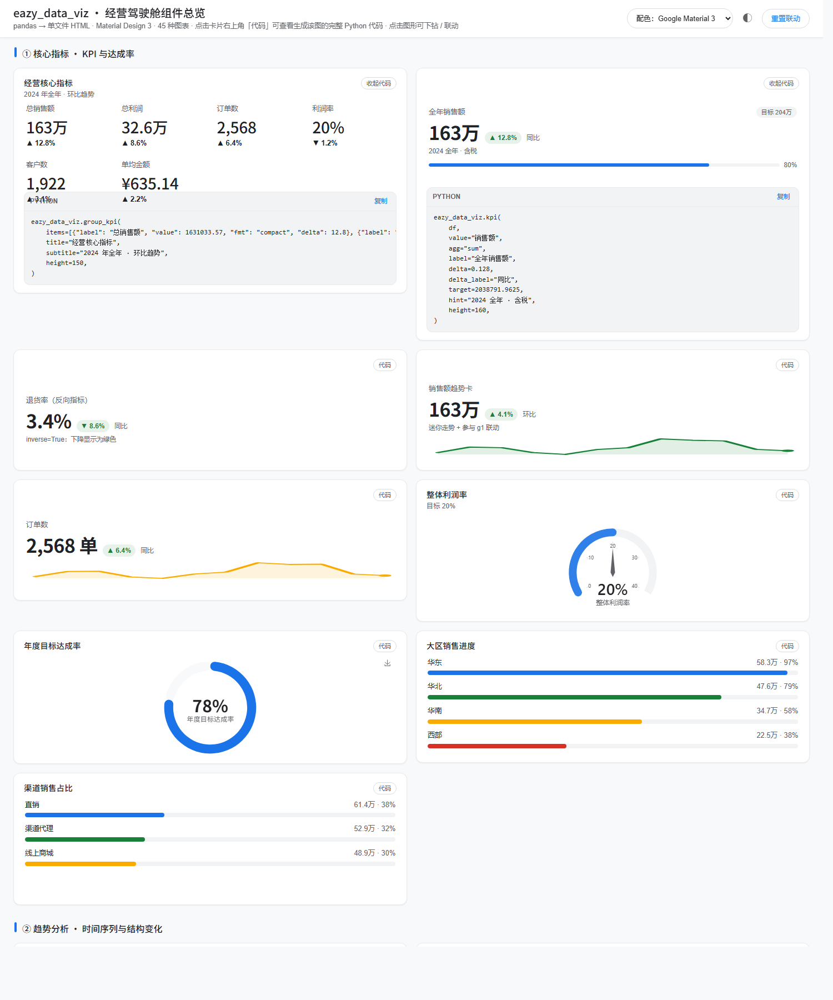
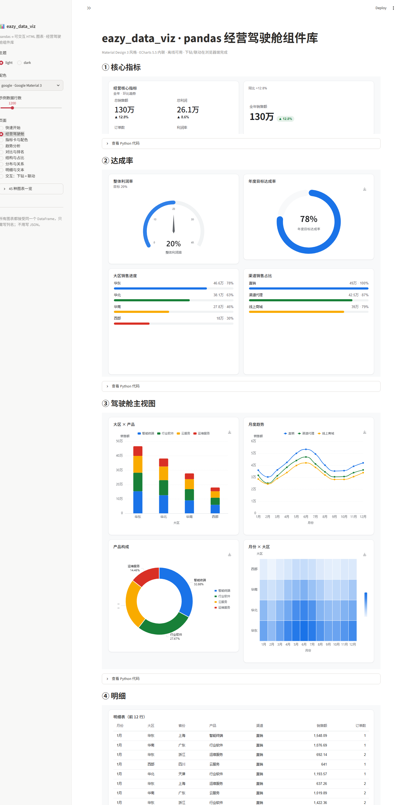

# eazy_data_viz · pandas 经营驾驶舱图表组件库

> 给 pandas 用的 **HTML 交互式图表库**：48 种图表、Material Design 3 视觉、
> 客户端下钻与联动、Streamlit 兼容、离线可用。调用方式只有一个原则——
> **传 DataFrame + 列名**，不写 JSON、不写配置。

```python
import pandas as pd
import eazy_data_viz as edv

df = pd.read_excel("经营数据.xlsx")          # 你的 DataFrame
edv.bar(df, x="大区", y="销售额", color="产品").show()
```

## 预览

| 画廊（每张图可展开生成它的完整 Python 代码） | Streamlit 画布 |
| --- | --- |
|  |  |

完整的 73 张卡片效果见 [docs/images/gallery_preview.png](docs/images/gallery_preview.png)，
也可以直接打开仓库根目录的 `gallery.html` 离线浏览。

---

## 1. 为什么用它

| 能力 | 说明 |
| --- | --- |
| **48 种图表** | 从 KPI 卡、瀑布图、帕累托、子弹图，到桑基图、旭日图、K 线、甘特图、相关矩阵 |
| **下钻 / 联动** | 点击柱形逐级下钻（大区 → 省份 → 城市），同组图表点击即交叉筛选；**全部在浏览器内完成**，不触发服务器往返；联动方向可按需设成双向 / 单向进 / 单向出 |
| **自由排列看板** | `layout=` / `direction=` 按列/行分配图表数，或 `grid=(3,3)` + `[[2,2],[1,1]]` 占位；整块网格拼成矩形；`abs_height=True` 让框与框严格等高 |
| **卡片外框 / 透明底** | `card_style` 三档：`"plain"`（默认，透明无框，页面底色直接透上来）/ `"card"`（实心白卡）/ `"glass"`（半透明 + 背景模糊）；`hints=True` 才显示操作提示小字 |
| **KPI 对比引擎** | `compare={"年": ["2026年", "2025年"]}`：同比/环比现算，去年为空、0、负数都有规则，联动后自动重算 |
| **指标选择器** | `kpi(..., metric="sale")` 让卡片变成按钮，点它所有写 `edv.follow()` 的图换口径；`edv.column(...)` 一次声明每列怎么汇总 |
| **卡片选择器** | KPI 卡片带 `metric=` 就是一个按钮：`bar(df, x="月", y=edv.follow())` 的图跟着选中的卡换列换聚合（销量/金额/客户数…），纯前端不 rerun；`edv.column(...)` 一次性声明每列怎么汇总 |
| **同比 / 汇总表** | `bar(yoy=True)` 两系列自动标注同比；`table(groupby={...})` 只在显示层汇总，不影响后台联动 |
| **Material Design 3** | Google 配色与排版（Roboto、Google Blue `#1a73e8`、8/12px 圆角、卡片阴影、深浅两套主题） |
| **窄屏自适应** | 手机 / 平板 / 窄侧栏自动改版：KPI 卡每行两张、图表与表格占满整行、KPI 数字自动缩放、图例按实际宽度换行、饼图窄屏改底部图例；桌面端外观不变 |
| **调用极简** | 只有 `图表函数(df, x=..., y=...)`，自动识别数值 / 时间 / 分类列、自动排序、自动标题 |
| **中文本地化** | 数值自动按「万 / 亿」缩略，也可 `.unit("万")` 强制统一单位；日期类目轴自动显示成 `3月1日`，跨年补年份 |
| **中国式报表** | 明细表支持序号列、表尾合计、单元格数据条、斑马纹，接近 FineReport / 观远 BI 的交付观感 |
| **Streamlit 兼容** | 优先 `st.components.v2`（无 iframe、自动高度、点击回传 Python），旧版自动回退 `components.v1.html` |
| **离线可用** | ECharts 与全部运行时内联进 HTML，单文件即可发给别人；不依赖 CDN |
| **源码随图** | gallery 里每张卡片右上角「代码」可展开生成该图的完整 Python 代码，支持一键复制 |
| **驾驶舱开箱即用** | KPI 指标组、达成率、筛选联动（图 ↔ 表双向）、明细表、主题切换、一键重置联动 / 重置下钻 |

---

### 文档导航

> 先读 [`docs/KNOWN_ISSUES.md`](docs/KNOWN_ISSUES.md)：里面有每个图表的「参数生效范围」。

| 文档 | 内容 |
| --- | --- |
| [README.md](README.md)（本文件） | 人读：安装、48 种图表、KPI、配色、交互、Streamlit、FAQ |
| [docs/AI_GUIDE.md](docs/AI_GUIDE.md) | 给 AI 的说明书：规则、选图决策表、签名 + 可运行示例、错误对照 |
| [docs/eazy_catalog.json](docs/eazy_catalog.json) | 机器可读目录（46 个图表条目的签名/参数/示例），由 `tools/gen_ai_doc.py` 生成 |
| [docs/EXTRA_CHARTS.md](docs/EXTRA_CHARTS.md) | 扩展图表契约（Python spec ⇄ JS builder），加新图看这份 |
| [CHANGELOG.md](CHANGELOG.md) / [CONTRIBUTING.md](CONTRIBUTING.md) | 版本记录 / 参与开发 |
| [examples/](examples) | 6 个可直接运行的示例（驾驶舱、KPI、配色、下钻联动、Streamlit） |

## 2. 环境与安装

**已验证**：

| Python | pandas | Streamlit | 状态 |
| --- | --- | --- | --- |
| 3.8.10 | 2.0.3 | 1.27.1 | ✅ 全部测试通过 |
| 3.12.14 | 2.x | 1.67.0 | ✅ |
| **3.14.10** | **3.1.1** | **1.67.0** | ✅ 全部测试通过（`tests/test_eazy.py` PASS 28） |

```bash
pip install .                 # 只装核心（pandas）
pip install ".[streamlit]"    # 需要 Streamlit 时
pip install ".[notebook]"     # 需要 Jupyter 时
```

只用 pandas 一个硬依赖；`streamlit` / `ipython` 是可选 extra。
不依赖 pyecharts / plotly / selenium。

---

## 3. 30 秒上手

```python
import eazy_data_viz as edv

df = edv.sample_df()            # 示例数据（1500 行，也可直接换自己的 df）

# 1) 单图：脚本里会打开浏览器；笔记本里内联；Streamlit 里自动嵌入组件
edv.bar(df, x="大区", y="销售额", color="产品", stack=True).show()

# 2) 存成独立 HTML（发给业务方，双击就能用）
edv.line(df, x="月份", y="销售额", color="渠道", smooth=True).save("trend.html")

# 3) 经营驾驶舱：多图放进同一个页面，才能互相联动
edv.show(
    edv.group_kpi(items=[
        {"label": "总销售额", "value": df["销售额"].sum(), "fmt": "compact", "delta": 12.8},
        {"label": "利润率", "value": 19.97, "fmt": "percent", "delta": -1.2},
    ]),
    edv.bar(df, x="大区", y="销售额", color="产品", link="g1"),
    edv.line(df, x="月份", y="销售额", link="g1"),
    edv.heatmap(df, x="月份", y="大区", value="销售额"),
    cols=2, title="经营驾驶舱",
)
```

`edv.help()` 会打印 48 种图表的速查表；`edv.gallery()` 启动 Streamlit 版画廊。

更多可运行示例见 [`examples/`](examples)：`cockpit.py`（完整驾驶舱）、`kpi_cards.py`、
`palettes.py`、`drill_link.py`、`streamlit_app.py`，以及
[`streamlit_sales_demo/`](examples/streamlit_sales_demo)（把 ERP 里全是主键的销售明细
翻译成中文名，做出一整套经营分析看板 + 中国式报表）。

**三种输出载体**（同一份 spec）：

| 方法 | 场景 |
| --- | --- |
| `.show()` | 自动判别：Streamlit → `components.v2`（旧版回退 `components.html`）；Jupyter → `IPython.display`；脚本 → 临时文件 + 浏览器 |
| `.to_html()` | 拿到 HTML 字符串，自己塞进模板 / iframe / OSS |
| `.save(path)` | 落地静态 `.html`，离线分发（体积约 1.1 MB，含 ECharts） |
| `edv.dashboard(...) / edv.show(...)` | 多图看板（跨图联动必须走这里） |

---

## 4. 图表函数（48 种）

所有函数第一个参数都是 DataFrame，其余只需要列名和少量关键字参数。
`data` 一律可省列名详述如下；`*` 之后是只允许关键字传的参数。

### 4.1 指标类

```python
edv.kpi(df, value="销售额", agg="sum", label="全年销售额", delta=0.128, fmt="compact")
edv.group_kpi(df, names="大区", values="销售额")            # 每个类目一张卡
edv.group_kpi(items=[{"label": "总利润", "value": 32.6, "delta": 8.6}])
edv.gauge(19.97, label="利润率", min=0, max=40, fmt="percent")
edv.ring_progress(78, label="目标达成率", max=100)
edv.progress(df, x="大区", y="销售额", max=600000)          # 进度条列表
```

### 4.2 趋势类

```python
edv.line(df, x="月份", y="销售额", color="渠道", smooth=True, step=False, area=False)
edv.area(df, x="日期", y="订单数")
edv.area_pct(df, x="月份", y="销售额", color="产品")        # 百分比堆叠面积
edv.bar_pct(df, x="月份", y="销售额", color="渠道")         # 百分比堆叠柱
edv.theme_river(df, x="月份", color="产品", value="销售额")  # 主题河流
edv.sparkline(df, x="月份", y="销售额", group="渠道")       # 迷你走势（多行小图）
edv.trend(df, x="销售额", y="利润", color="产品")           # 散点 + 回归线（R²）
edv.combo(df, x="月份", bar="销售额", line="利润", zoom=True)
edv.candlestick(df, date="日期", open="开盘", high="最高", low="最低", close="收盘")
edv.calendar(df, date="日期", value="销售额")               # 日历热力图
```

### 4.3 对比与排名

```python
edv.bar(df, x="省份", y="销售额", color="产品", stack=True, horizontal=False,
         top_n=10, sort=None, percent=False)
edv.waterfall(df, x="产品", y="销售额", total=True)         # 瀑布图
edv.pareto(df, x="省份", y="销售额", top_n=8)               # 帕累托 80/20
edv.lollipop(df, x="产品", y="销售额")                      # 棒棒糖图
edv.dumbbell(df, x="省份", y1="上半年", y2="下半年")        # 哑铃图
edv.slope(df, x="省份", y="利润率", color="期间")           # 斜率图
edv.bump(df, x="月份", y="销售额", group="产品")            # 排名变化
edv.bullet(df, x="大区", actual="销售额", target_value=500000)   # 子弹图
edv.target(df, x="大区", actual="销售额", target="目标")     # 实际 vs 目标
edv.pictorial(df, x="大区", y="销售额", symbol="rect")       # 象形柱
edv.pyramid(df, names="渠道", values="销售额")
edv.funnel(df, names="产品", values="销售额")
```

### 4.4 结构与占比

```python
edv.pie(df, names="产品", values="销售额", donut=True)
edv.rose(df, names="产品", values="销售额", donut=False)     # 南丁格尔玫瑰
edv.treemap(df, path=["大区", "省份"], value="销售额")       # 矩形树图
edv.sunburst(df, path=["大区", "省份"], value="销售额")      # 旭日图
edv.tree(df, path=["大区", "省份"], value="销售额")          # 树图
edv.tile(df, names="省份", values="销售额", top_n=8)         # 瓦片图
```

### 4.5 分布与关系

```python
edv.histogram(df, column="销售额", bins=24)
edv.box(df, x="产品", y="销售额")
edv.scatter(df, x="销售额", y="利润", color="产品", size="订单数")
edv.quadrant(df, x="销售额", y="利润", size="订单数", color="大区")
edv.heatmap(df, x="月份", y="大区", value="销售额")
edv.matrix(df, columns=["销售额", "订单数", "利润", "客户数"])   # 相关矩阵
edv.radar(df, x="产品", y="销售额", color="大区", agg="mean")
edv.parallel(df, dims=["销售额", "订单数", "利润", "客户数"], color="大区")
edv.sankey(df, source="渠道", target="产品", value="销售额")
edv.graph(df, source="大区", target="城市", value="销售额")
edv.gantt(df, task="任务", start="开始", end="结束", color="负责部门")
```

### 4.6 明细与文本

```python
edv.table(df, columns=["月份", "大区", "销售额"], limit=12)
edv.wordcloud(df, names="城市", values="销售额", top_n=12)
```

### 4.7 地图

内置中国地图、**世界地图**与**北京区级地图**（本地 GeoJSON，离线可用，不依赖任何 CDN）；城市名支持
「广州 / 广州市」两种写法，内置 725 条城市名称/坐标映射，气泡图与飞线图按真实城市坐标落点。

```python
edv.geo_map(df, region="省份", value="销售额")                      # 中国省级填色
edv.geo_map(df, region="国家", value="销售额", map="world")         # 世界地图
edv.beijing_map(df, region="区", value="销售额")                    # 北京 16 区填色
edv.geo_map(df, region="省份", value="销售额", name_map={"广东": "广东省"})
edv.map_bubble(df, region="城市", value="销售额")                    # 城市气泡
edv.map_flow(df, source="出发城市", target="到达城市", value="件数")  # 城市飞线
```

- `region` 列写「广东 / 广东省」都可以，前端会自动归一化；匹配不到的区域会跳过并给出提示。
- 北京区级地图（`map="beijing"`）传区名即可，`"朝阳"` / `"朝阳区"` 两种写法都能匹配；
  非北京的区域会被跳过，可用 `edv.maps.known_region_keys("beijing")` 自查。
- 地图同样支持 `drill` 下钻、`link` 联动、`palette` 配色与深色主题。
- 地图数据放在 `eazy_data_viz/assets/maps/`（`china.json` / `world.json` / `beijing.json` / `china_cities.json`）。

---

## 5. 公共参数

几乎所有图表函数都支持（同名、同语义）：

| 参数 | 说明 |
| --- | --- |
| `title` / `subtitle` | 卡片标题 / 副标题（不给就按列名自动生成） |
| `xtitle` / `ytitle` | 坐标轴标题（默认取列名，过长自动缩写） |
| `agg` | 聚合方式：`sum` `mean` `count` `max` `min` `median` |
| `fmt` | 数值格式：`compact`（万/亿）`thousands` `raw` `percent` `currency` |
| `xlim` / `ylim` | 坐标范围（只作用于数值轴） |
| `sort` | `x` / `asc` / `desc` / `None`（自动：时间 → x，排名 → desc） |
| `top_n` | 只保留前 N 项（其余聚合为「其他」） |
| `height` | 图表区域高度（px），卡片高度自动适配 |
| `theme` | `light` / `dark`（页面内也可点 ◐ 实时切换） |
| `labels` | 是否显示数据标签（密集图默认关闭） |
| `zoom` | 底部缩放条（`True` / `"auto"` 按数据量自动） |
| `drill` | 下钻层级列表，如 `["大区", "省份", "城市"]` |
| `link` | 联动组名，同组图表共享筛选状态 |
| `legend` | 是否显示图例 |
| `section` | 看板分区标题（同名的图会归到一栏） |
| `max_rows` | 超过后自动均匀采样（默认 200000 行；传 `None` 表示不采样） |

---

## 6. KPI 卡片

驾驶舱最上面那一排指标卡。`edv.kpi()` 既能接 DataFrame（聚合后参与联动过滤），
也能直接给一个数字（静态展示）。

```python
# 1) 接 DataFrame：自动 sum/mean/...；带目标 → 右上角徽标 + 达成率进度条
edv.kpi(df, value="销售额", label="全年销售额", delta=0.128, delta_label="同比",
         target=2000000, hint="2024 全年 · 含税").show()

# 2) 加一条迷你走势线（按 spark_x 聚合 spark 列）
edv.kpi(df, value="销售额", label="销售额趋势",
         spark="销售额", spark_x="月份", accent=1).show()

# 3) 反向指标：成本/退货率这类「下降是好事」，inverse=True 时下降显示绿色
edv.kpi(3.4, label="退货率", fmt="percent", delta=-0.086, inverse=True).show()

# 4) 参与联动：link="g1" 的 KPI 会随同组图表点击自动重算
edv.kpi(df, value="销售额", label="销售额（联动）", link="g1",
         spark="销售额", spark_x="月份").show()
```

| 参数 | 说明 |
|---|---|
| `data` / `value` / `agg` | 传 df + 列名（参与联动）或直接传数字 |
| `label` / `hint` | 主标签 / 下方灰色说明 |
| `fmt` / `unit` / `prefix` | `compact`(163万) / `thousands` / `raw` / `percent` / `currency`，可加单位和前缀 |
| `delta` / `delta_label` / `inverse` | 同比环比涨跌；`inverse=True` 反转红绿 |
| `target` / `target_label` | 目标值 → 徽标「目标 200万」+ 达成率进度条（超额时数字显示真实百分比） |
| `spark` / `spark_x` | 迷你走势线 |
| `accent` | 用当前配色的第 N 个颜色做强调色 |
| `link` | 联动组名，点同组图表时该 KPI 重算 |

## 7. 配色库

7 套经过挑选的配色，一套色板同时决定：图表分类色、热力色阶、仪表盘、KPI 强调色。

| 名字 | 风格 | 适合 |
|---|---|---|
| `google`（默认） | Google Material 3 | 通用经营看板、对外汇报 |
| `antd` | Ant Design | 中后台、企业系统 |
| `tableau` | Tableau 10 | 数据分析报告、BI |
| `carbon` | IBM Carbon | 技术/工业感大屏 |
| `echarts` | ECharts 默认 | 和现有 ECharts 项目混排 |
| `morandi` | 莫兰迪低饱和 | 高级感、打印、PPT |
| `tailwind` | Tailwind 现代色 | 网页产品、仪表盘 |

```python
edv.bar(df, x="大区", y="销售额").palette("tableau").show()   # 单图换配色
edv.bar(df, x="大区", y="销售额", palette="morandi")          # 也可以直接传参
edv.dashboard(c1, c2, palette="carbon").save("dash.html")     # 整页换配色
edv.set_palette("antd")                                       # 改全局默认
edv.palettes()                                                # 列出所有配色
```

页面上还内置了顶栏「配色」下拉框和深浅色切换按钮，演示时可以直接切换给别人看。
每套配色的具体色值在 `eazy_data_viz/palette.py`，想加自己的色板照着加一个字典即可。

## 8. 交互能力（全部在浏览器内）

- **下钻**：`drill=["大区","省份","城市"]`，点击柱形进入下一层，顶部面包屑可回退任意层。
- **联动**：`link="g1"`，点击任一图的柱 / 点 / 扇区，同组图表一起过滤；顶部出现筛选 chip，再点一次取消；顶栏「重置联动」清空全部。
  1.4.0 起**表格也双向**：`table(link="g1")` 点表里的维度单元格即可筛同组图表，命中的行会高亮。
- **图例筛选**：点击图例显示 / 隐藏系列（跨图同步）。
- **缩放**：`zoom=True` 或数据量大时自动出现底部滑块，滚轮可缩放。
- **主题切换**：顶栏 ◐ 在 light / dark 之间实时切换，图表与页面一起变。
- **导出图片**：每张图右上角工具箱可直接下载 PNG。

> 注意：跨图联动要求这些图表在**同一个 HTML 文档**里，即用 `edv.show(...)` / `edv.dashboard(...)` 一次渲染。
> 每个 `.show()` 是独立 iframe，独立的图之间不会联动。

---

## 9. Streamlit 用法

**推荐：`st.components.v2`（Streamlit ≥ 1.50）**——没有 iframe、高度按内容自适应、点击还能回传 Python：

```python
import streamlit as st
import eazy_data_viz as edv

df = edv.sample_df()
charts = [
    edv.group_kpi(items=[...]),
    edv.bar(df, x="大区", y="销售额", link="g1"),
    edv.line(df, x="月份", y="销售额", link="g1"),
]

# 默认：零 rerun，点图 / 联动 / 下钻全在浏览器里完成，result.select 为 None
result = edv.streamlit_dashboard(charts, cols=2, title="经营驾驶舱")

# 需要 Python 感知点击时才传 on_select（点击会触发一次 rerun）
def on_click():
    st.toast("图表被点击了")

result = edv.streamlit_dashboard(charts, cols=2, on_select=on_click)
if result.select:            # 点击图表后，Python 收到事件
    st.write(result.select)  # {chart, title, type, dim, value, drill, link}
```

- `.show()` / `edv.dashboard(...).show()` 会自动优先走 v2，旧版 Streamlit 自动回退到 v1；
  在普通布局里单独放一张图也可以直接 `edv.bar(df, x="大区", y="销售额").show()`。
- v2 不需要自己算高度（`height=None` 即按内容撑开）；传 `height=800` 可以固定高度。
- **默认 0 rerun**：不传 `on_select` 时点击 / 联动 / 下钻全部在浏览器内完成（`result.select` 为 `None`）。
- 双向事件：传 `streamlit_dashboard(..., on_select=回调)` 后，点击会 trigger 一次脚本 rerun，再读取 `result.select`；
  `gallery/app.py` 的「v2 双向事件」页有完整演示。

**旧版回退（`st.components.v1.html`，需要显式 height）**：

```python
import streamlit.components.v1 as components
from eazy_data_viz import render as edv_render

page = edv.dashboard(*charts, cols=2, title="经营驾驶舱")
components.html(
    page.to_html(),
    height=edv_render.page_height(page.charts, cols=2, has_header=True, has_filters=True),
    scrolling=False,
)
```

- 不要用 `st.html`：它会过滤脚本，ECharts 不会运行。
- 同一 dashboard 内的图表才能跨图联动；两次 `.show()` 是两块独立组件。
- 完整示例见 `eazy_data_viz/gallery/app.py` 与 `examples/streamlit_app.py`。

---

## 10. 静态 HTML / 交付给业务方

```python
edv.show(...).save("dashboard.html")
```

得到一个自包含 `.html`（约 1.4 MB / 50 张图，ECharts 内联），双击即可打开、离线可用。
这也正是仓库根目录 `gallery.html` 的生成方式：`python tools/build_gallery.py`。
画廊里 **73 张卡片 / 48 种图表**，每张卡片右上角「代码」按钮会展开生成该图的完整
Python 代码（由构建脚本自动录制，和实际出图代码完全一致），可一键复制。

---

## 11. 数据要求

- 输入任意 `pandas.DataFrame`；列会被自动识别为 **数值 / 时间 / 分类 / 布尔**。
- 数值列里的字符串会尝试转数字；无法识别的为 NaN，按图表各自规则忽略。
- 时间列支持 `datetime64`、`YYYY-MM-DD`、`YYYY-MM-DD HH:MM:SS` 字符串。
- 有序分类（`pd.Categorical(..., ordered=True)`）会保留你定义的顺序（如 1月..12月）。
- 数据默认最多 **200000 行**（超出才均匀采样），列最多 40 列；需要更多可用 `max_rows=300000` 调大，`max_rows=None` 完全不采样。
- 行数越大，生成的 HTML 越大（约每万行 0.5MB）：200k 行 × 6 列约 10MB；建议只传绘图用到的列，或用 `top_n`/筛选先聚合。
- 多图共享同一份 DataFrame 时，页面里只嵌入一次数据（看板体积更小）。

---

## 12. 和其它方案对比

| 方案 | 图表数 | 下钻 | 跨图联动 | Streamlit | 离线 | 备注 |
| --- | --- | --- | --- | --- | --- | --- |
| **eazy_data_viz** | **48** | ✅ 客户端 | ✅ 同一文档内 | ✅ `components.v2`（回退 v1） | ✅ 全内联 | 传 df + 列名即可，无 JSON |
| streamlit-echarts | ECharts 全家桶 | 需回服务器 | ❌ 每个组件独立 iframe | ✅ | 依赖 ECharts 资源 | 灵活但要自己写 option JSON |
| pyecharts | 多 | 需回服务器 | ❌ | 需适配 | 默认走 CDN | Python 侧拼 option |
| plotly | 多 | 需 `on_select`（Streamlit≥1.35） | 部分 | ✅ | 需内联 plotly.js（≈3 MB） | 体积大 |
| altair | 中 | ❌ | 单图内可 | ✅ | ✅ | 跨图联动不支持 |
| bokeh | 中 | 需服务器 | 需服务器 | 需嵌入 | ❌ | Python 3.9+ |

---

## 13. 架构

```
DataFrame ──(frame.py)──> 紧凑记录 {cols, rows, kinds, orders}
                              │
图表函数 ───(chart.py / charts_extra.py)──> spec（JSON，内部生成，用户不接触）
                              │
                          (render.py) ──> 自包含 HTML（ECharts + 运行时内联）
                              │
浏览器：eazy.js 负责聚合 / 构建 option / 交互；eazy_extra_*.js 提供扩展图表
```

- Python 只做 **校验 + 角色识别 + 少量预计算**（如回归拟合、相关矩阵、KPI 汇总）。
- 聚合在前端按「当前筛选状态」实时计算，所以联动过滤后所有图自动重算。
- 新增图表只需在 JS 注册 `EazyViz.extraBuilders[type]`（或 `htmlBuilders[type]`），契约见 `docs/EXTRA_CHARTS.md`。

### 目录结构

```
eazy_data_viz/                    # 库本体
  __init__.py            # 门面：48 个图表函数 + show/dashboard/help/gallery/sample_df
  frame.py               # DataFrame → 记录、列类型识别、采样、有序类目
  chart.py               # 基础 14 种图表 + 公共参数校验
  charts_extra.py        # 扩展 31 种图表
  render.py              # 页面组装、Material Design 3 CSS、卡片代码区、Streamlit 适配
  palette.py             # 7 套配色库
  gallery/app.py         # Streamlit 版画廊
  gallery/gallery.html   # 静态版画廊（构建产物，随包分发）
  assets/
    echarts.min.js       # ECharts 5.5（内联，离线）
    eazy.js              # 运行时：主题、聚合、下钻、联动、渲染
    eazy_extra_main.js   # 瀑布 / 子弹 / 棒棒糖
    eazy_extra_a.js      # 14 种对比 / 分布类
    eazy_extra_b.js      # 11 种层次 / 关系类
    eazy_extra_html.js   # HTML 类：KPI 组、进度条、瓦片、表格、词云
tools/
  build_gallery.py       # 生成 gallery.html（64 卡片 / 45 类型 / 8 分区，自动录制代码）
  gen_ai_doc.py          # 生成 docs/AI_GUIDE.md + docs/eazy_catalog.json
tests/
  test_eazy.py           # Python 测试（42 项）
  test_maps.py           # 地图测试（33 项）
  js_test.py             # 前端测试（136 项，headless Chrome 内断言）
  js_test_15.py          # 1.5 新增能力的前端测试（112 项）
  e2e_test.py            # 端到端：浏览器里模拟点击，走一遍 show / dashboard 联动
examples/                # 可直接运行的示例（驾驶舱 / KPI / 配色 / 下钻联动 / Streamlit）
  streamlit_sales_demo/  # 销售经营分析看板（含 prepare_data.py 主键→中文名转换）
docs/
  AI_GUIDE.md            # 给 AI 的说明书（人读）
  eazy_catalog.json      # 机器可读目录（由 gen_ai_doc.py 生成）
  EXTRA_CHARTS.md        # 扩展图表契约
  images/                # 截图（gallery_preview / gallery_streamlit / ...）
gallery.html             # 静态画廊（构建产物，双击即用）
README.md / CHANGELOG.md / CONTRIBUTING.md / LICENSE
setup.py / pyproject.toml / MANIFEST.in
```

---

## 14. 测试

```bash
python tests/test_eazy.py     # Python：基础图 + 参数校验 + 自由排列 + groupby + 同比 + 联动方向
python tests/test_maps.py     # Python：地图（GeoJSON / 省市区匹配 / 联动）
python tests/js_test.py       # 前端：聚合 / option / 下钻 / 联动 / 配色 / 卡片代码区（headless Chrome）
python tests/js_test_15.py    # 前端：1.5 新增（多级桑基 / 汇总表 / 同比 / 联动方向 / 词云 shape / 旭日放大）
python tests/e2e_test.py      # 端到端：模拟真人点击，验证 show / dashboard 的联动链路
```

当前状态：`PASS 53` + 地图 `PASS 33`；前端 `JS PASS 137`、`JS PASS 173`；端到端 `E2E PASS 42`，全部 0 失败。

---

## 15. FAQ

**Q：中文乱码或控制台报 `UnicodeEncodeError`？**
Windows 终端设 `PYTHONIOENCODING=utf-8`；HTML 本身统一 UTF-8，浏览器里不会乱码。

**Q：HTML 文件为什么 1 MB 多？**
ECharts 5.5 压缩后约 1 MB，内联才能离线单文件。多图共享同一份 ECharts 与数据，所以 1 张和 50 张差距不大（1.07 MB → 1.4 MB）。

**Q：图表不显示 / 一片空白？**
① Streamlit 里没给 `height`（默认 150px 被裁）；② 数据被过滤空了（看顶栏筛选 chip）；③ 浏览器控制台 `#eazy-js-error` 会显示具体错误。

**Q：能换成自己的品牌色吗？**
改 `eazy_data_viz/assets/eazy.js` 顶部 `PALETTE_LIGHT` / `PALETTE_DARK` 与 `THEME` 里的 CSS 变量即可；页面样式在 `render.py` 的 `_CSS`。

**Q：想在 iframe 里点击后回调 Python？**
图表内的下钻/联动仍是纯前端（无服务器往返）。需要把点击事件交给 Python 时用 `edv.streamlit_dashboard(charts, on_select=...)`：它基于 `st.components.v2`，点击会通过 trigger 回传，读取 `result.select` 即可；旧版 Streamlit 会自动回退到 v1（此时没有 Python 回调）。

---

MIT License · 数据只嵌入一次 · 离线可用 · 不引入 pandas 之外的运行时依赖
